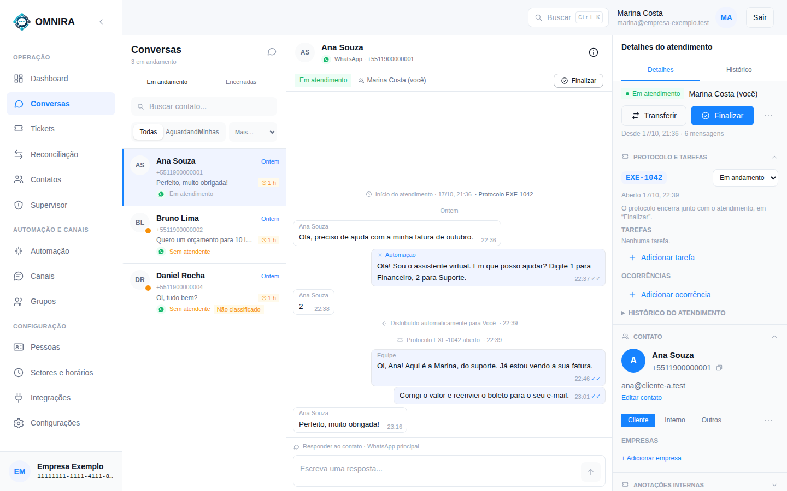
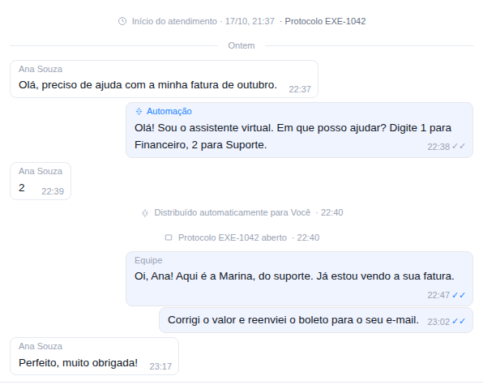
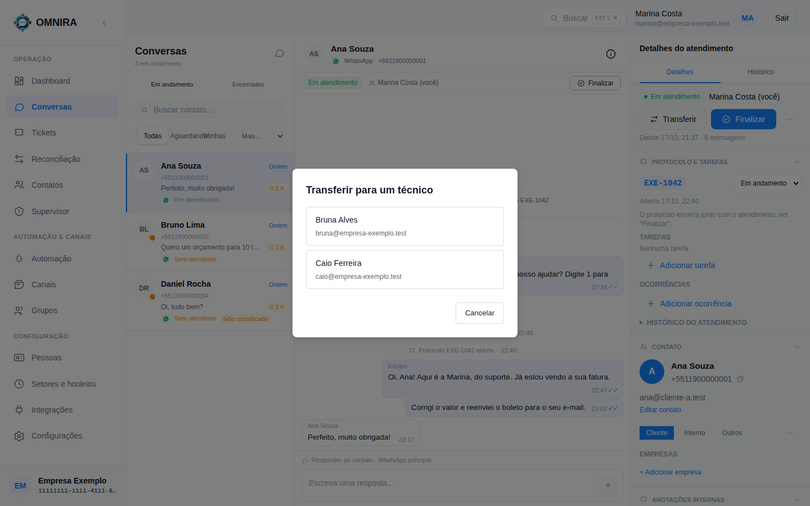
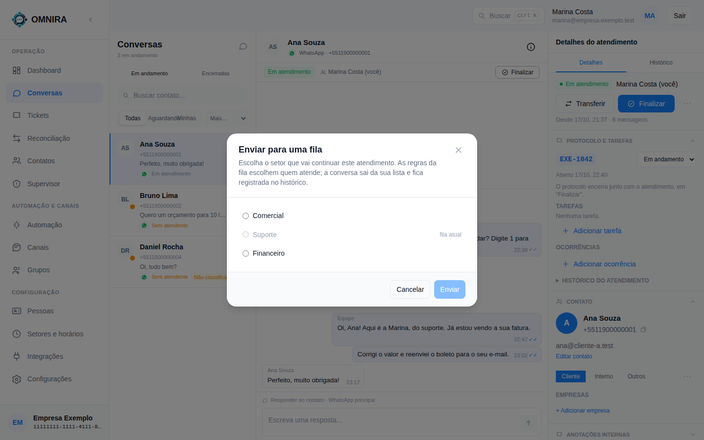
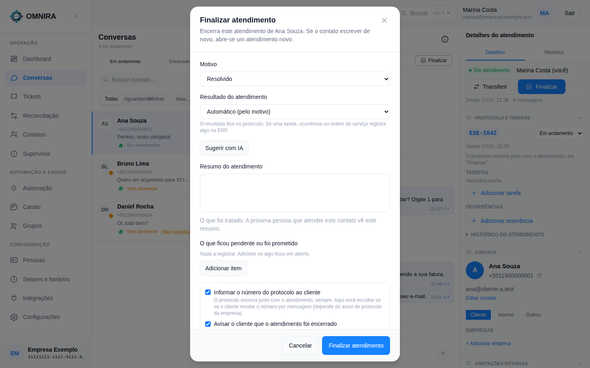

# Tutorial 1: atender uma conversa do começo ao fim

**Para quem:** atendente. **Tempo:** 5 minutos. **No fim você sabe:** assumir, responder, mandar um arquivo, passar para outra pessoa ou setor e finalizar com o protocolo.

## 1. Encontre a conversa

Abra **Conversas**. A lista da esquerda mostra as conversas **Em andamento**; a aba **Encerradas** guarda as finalizadas.

Em cada linha você vê o nome, o telefone, a última mensagem e:

- **Quanto tempo o cliente espera** (o relógio vermelho ou laranja quando passa do limite que a empresa definiu).
- **Em atendimento** (já tem alguém) ou **Sem atendente**.
- **Não classificado**, quando ninguém disse ainda se o contato é cliente, interno ou outro (veja o [Tutorial 4](04-classificar-contatos-e-spam.md)).

Use os filtros **Todas**, **Aguardando** e **Minhas**, ou **Buscar contato** acima da lista.

## 2. Assuma

Se a conversa está **Sem atendente**, clique em **Assumir** (no alto da conversa). Ao assumir:

- a conversa passa a ser sua e aparece em **Minhas**;
- nasce o **protocolo** do atendimento (por exemplo `EXE-1042`), que aparece em *Protocolo e tarefas*;
- uma linha discreta registra o fato no meio da conversa: "Protocolo EXE-1042 aberto".

Se o sistema distribuiu a conversa automaticamente para você, a linha diz "Distribuído automaticamente para Você".

## 3. Leia e responda

No centro, as mensagens do cliente ficam à esquerda e as da empresa à direita. Cada bloco de mensagens da empresa mostra **quem falou**:

| Rótulo | Quem foi |
|---|---|
| **Equipe** | uma pessoa da empresa |
| **Automação** | o assistente automático (menu de boas-vindas, avisos) |
| **Aplicativo externo** | um CRM ou outro sistema ligado pela API |
| **Celular da empresa** | alguém respondeu direto do celular, fora do OMNIRA |

Entre as mensagens aparecem **linhas de evento** em cinza: quem assumiu, atribuiu, soltou, transferiu, enviou para fila, o protocolo aberto e encerrado, e a finalização.

Escreva no campo **Escreva uma resposta...** e use o botão de enviar. Debaixo do campo aparece por qual número a resposta sai.

**Mandar um arquivo:** clique no clipe (**Anexar arquivo**), escolha o arquivo e envie. É **um arquivo por mensagem**; o texto digitado vira a legenda. Se a empresa desligou os anexos de saída, o clipe fica inativo.

**Número oficial (Meta):** o WhatsApp oficial só aceita texto livre até 24 horas depois da última mensagem do cliente. A tela mostra o tempo que falta e, depois disso, só aceita mensagem de **template** aprovado.

## 4. Passe para outra pessoa ou outro setor

Os botões ficam em **Detalhes do atendimento**, à direita.

- **Transferir** abre a lista de **técnicos** disponíveis; escolha a pessoa que continua.

  

- No menu **⋯** (ao lado de Finalizar): **Soltar** devolve a conversa à fila; **Enviar para uma fila** manda para outro setor.

  

  As regras da fila escolhem quem atende, e a conversa sai da sua lista e fica registrada no histórico.

## 5. Finalize

Quando resolver, clique em **Finalizar**.

- **Motivo**: resolvido, sem resposta, duplicado, spam, transferido ou outro.
- **Resultado do atendimento**: automático pelo motivo, ou escolha um da lista.
- **Resumo do atendimento**: o que foi tratado. A próxima pessoa que atender esse contato vê esse resumo.
- **O que ficou pendente ou foi prometido**: itens para não esquecer.
- **Informar o número do protocolo ao cliente**: marcado, o cliente recebe o protocolo por mensagem (quando a empresa tem esse aviso ligado).
- **Avisar o cliente que o atendimento foi encerrado**.

**Finalizar** encerra a conversa **e** o protocolo juntos. Se o cliente escrever de novo, abre-se um atendimento novo, com protocolo novo.

## Se algo não funcionar

| Você vê | O que significa |
|---|---|
| Não consigo responder e a conversa mostra "Aplicativo externo" | um CRM está com a conversa; um supervisor pode retomá-la. Veja o [FAQ](../faq/FAQ.md) |
| "Janela de 24 h fechada" e o botão **Enviar template** | passou a janela de 24 horas do número oficial: só vai template aprovado |
| "A conversa mudou, tente novamente." (e o botão **Atualizar conversa**) | outra pessoa ou um sistema mexeu agora; clique em Atualizar conversa e tente de novo |
