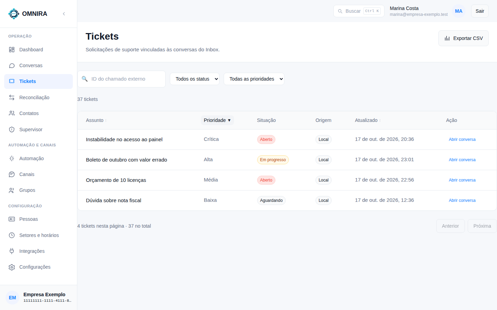
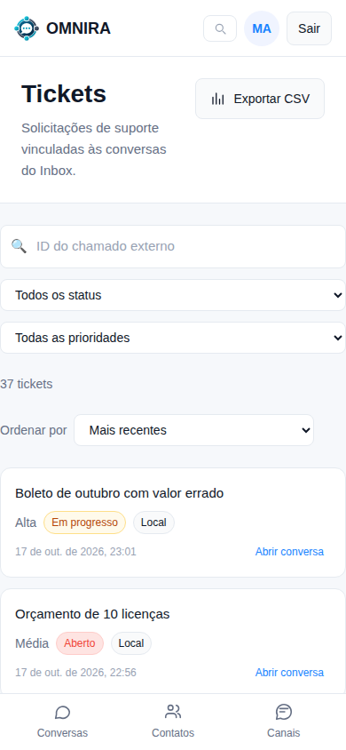
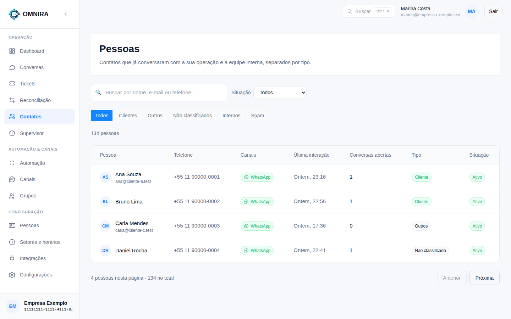

# Tutorial 3: Tickets e Pessoas (filtrar, ordenar, contar)

**Para quem:** atendente e supervisor. **Tempo:** 3 minutos.

## Tickets

**Tickets** lista as solicitações ligadas às conversas.

- **Filtre** por situação (aberto, em progresso, aguardando, resolvido, fechado), por prioridade ou pelo **ID do chamado externo** (o número do chamado no sistema da empresa, quando há).
- **Ordene** clicando no título da coluna: **Assunto** (A a Z, depois Z a A), **Prioridade** (mais urgente primeiro, depois menos urgente) e **Atualizado** (mais antigo primeiro). Clicar de novo avança no ciclo; depois do último volta à ordem padrão (mais recentes primeiro). A coluna que ordena mostra uma seta e é a única marcada.
- **Quantos há:** acima da tabela aparece o total ("37 tickets", ou "37 tickets com estes filtros"), e no rodapé "4 tickets nesta página · 37 no total".
- **Exportar CSV** baixa o resultado filtrado.
- **Abrir conversa** leva à conversa do ticket.

### No celular

Os resultados viram cartões e não há títulos para clicar. Use o menu **Ordenar por** acima dos cartões, com as mesmas opções.

## Pessoas (Contatos)

O item **Contatos** do menu abre a tela **Pessoas**: quem já falou com a empresa e a equipe interna, separados por tipo (Todos, Clientes, Outros, Não classificados, Internos, Spam).

- **Buscar** por nome, e-mail ou telefone.
- **Situação**: ativos, bloqueados, arquivados (e inativos, para a equipe).
- **Ordenar** por **Pessoa** clicando no título (A a Z, Z a A, padrão). No celular, use **Ordenar por**.
- O total aparece acima da lista ("134 pessoas") e no rodapé ("20 pessoas nesta página · 134 no total"). O total é contado ao abrir a primeira página e se mantém ao avançar.
- Os **filtros ativos** aparecem como etiquetas que você remove com um clique, e **Limpar tudo** zera.

Mudou o filtro ou a ordem? A lista volta para a primeira página, porque a posição só vale para aquela combinação.
