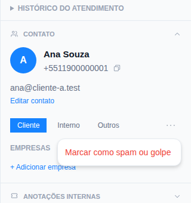

# Tutorial 4: classificar o contato e tratar spam

**Para quem:** atendente. **Tempo:** 2 minutos.

Todo contato novo chega **Não classificado**. A classificação diz ao sistema como tratar a pessoa: cliente, interno ou outro.

## Classificar

No painel **Detalhes do atendimento**, seção **Contato**, escolha:

- **Cliente**: uma pessoa que compra ou usa o serviço. O sistema pede a empresa dela (ou cria um cadastro pessoal para quem não tem empresa).
- **Interno**: gente de fora da conta de usuário mas da casa, como equipe em número pessoal, parceiro ou fornecedor. Você escolhe qual dos três. **Contato interno não recebe a automação de cliente** (bot, ticket, tempo de espera).
- **Outros**: qualquer outra pessoa.

Enquanto está **Não classificado**, o atendimento é limitado: o próprio painel avisa "Ainda não classificado: o atendimento é limitado até você dizer se é cliente, interno ou outro contato."

Quem é da sua equipe e tem usuário no OMNIRA **não é contato**: aparece em Pessoas, na parte de equipe.

## Spam ou golpe

Contato não classificado: use o link vermelho **Marcar como spam ou golpe**.

Contato já classificado: abra o menu **⋯** da seção Contato e escolha **Marcar como spam ou golpe**. O botão fica escondido no menu de propósito, para ninguém clicar sem querer.

O sistema **pergunta antes**. Ao confirmar:

- as conversas desse contato ficam só na caixa **Spam** e **não entram na fila**;
- nada é apagado.

Foi engano? Abra a conversa na caixa **Spam** (menu **Mais...** da lista de conversas) e use **Não é spam** (o contato volta como "Outros") ou **É cliente**.
