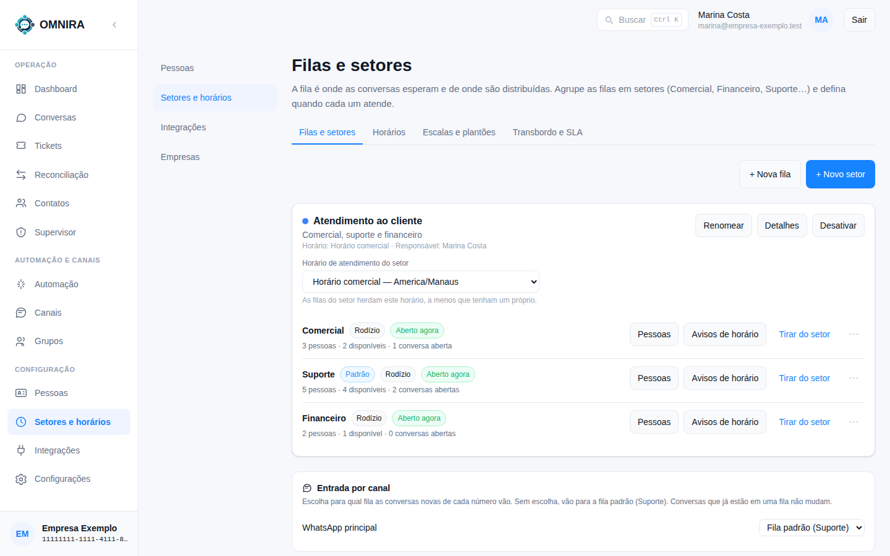

# Tutorial 5: filas, setores e horários

**Para quem:** administrador e supervisor. **Tempo:** 5 minutos para entender; a configuração leva mais.

Em **Setores e horários** você decide **para onde cada conversa vai** e **quando cada setor atende**.

## As ideias

- **Fila**: onde as conversas esperam e de onde são distribuídas. Cada fila tem um modo de distribuição (por exemplo **Rodízio**) e pode ser a **Padrão**.
- **Setor**: agrupa filas que compartilham o mesmo **horário** e um **responsável** (informativo). Exemplo: o setor "Atendimento ao cliente" com as filas Comercial, Suporte e Financeiro.
- **Horário**: define quando o setor atende ("Horário comercial", "Plantão 24 horas"). Fora dele, a conversa espera ou segue as regras de transbordo.

## A tela

As abas no alto: **Filas e setores**, **Horários**, **Escalas e plantões** e **Transbordo e SLA**.

Em **Filas e setores**:

- **+ Nova fila** e **+ Novo setor** criam.
- No cartão do setor: **Renomear**, **Detalhes** e **Desativar**, e o **Horário de atendimento do setor**. As filas do setor herdam esse horário, a menos que tenham um próprio.
- Em cada fila: quantas **pessoas** estão nela, quantas **disponíveis**, quantas **conversas abertas**, e se está **Aberta agora**. Os botões **Pessoas** (quem atende a fila), **Avisos de horário** (a mensagem que o cliente recebe fora do horário), **Tirar do setor** e o menu **⋯**.
- **Entrada por canal**: escolha para qual fila vão as conversas **novas** de cada número de WhatsApp. Sem escolha, vão para a **fila padrão**. Conversas que já estão numa fila não mudam.

## Quem vê o quê

A empresa pode ligar a **visibilidade por setor**. Ligada, o atendente vê só as conversas das filas dele, as que são dele e as que ainda não têm fila; supervisores e administradores continuam vendo todas. Isso vale para a lista, a busca (Ctrl+K), os tickets e os contatos.

## Para o CRM

As filas aparecem na API como **setores** que o CRM pode usar ao transferir uma conversa. Cada aplicação pode ser limitada a algumas filas (Tutorial 6).
