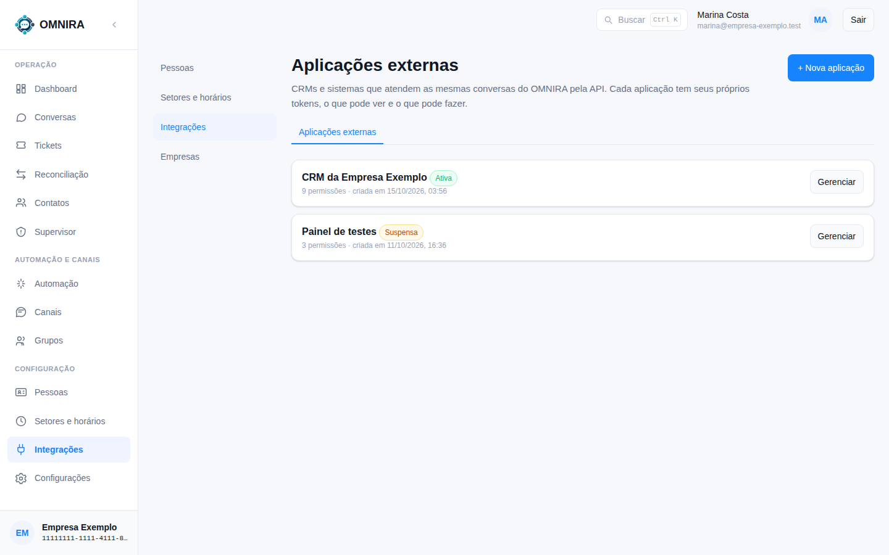
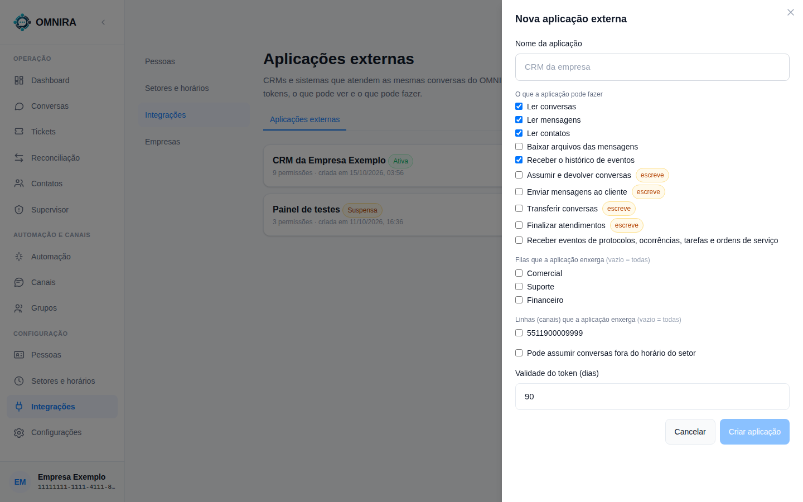
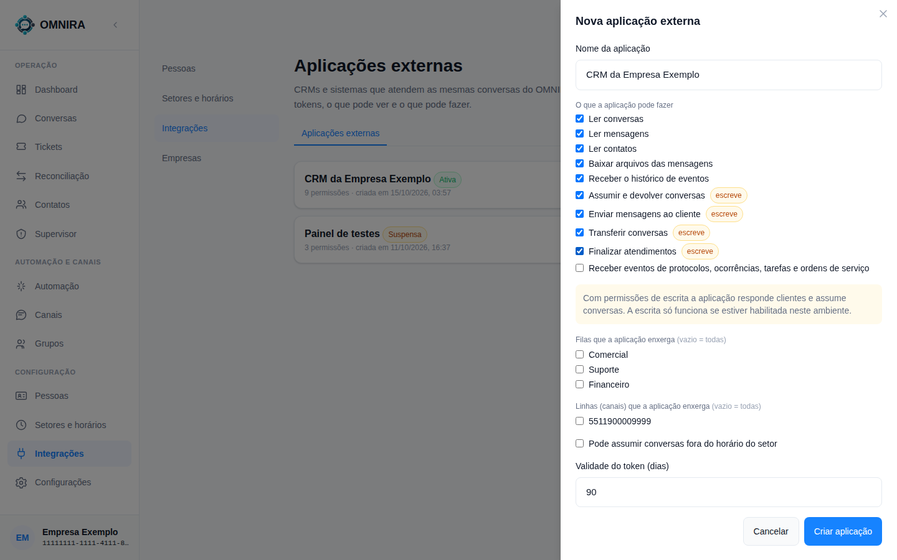
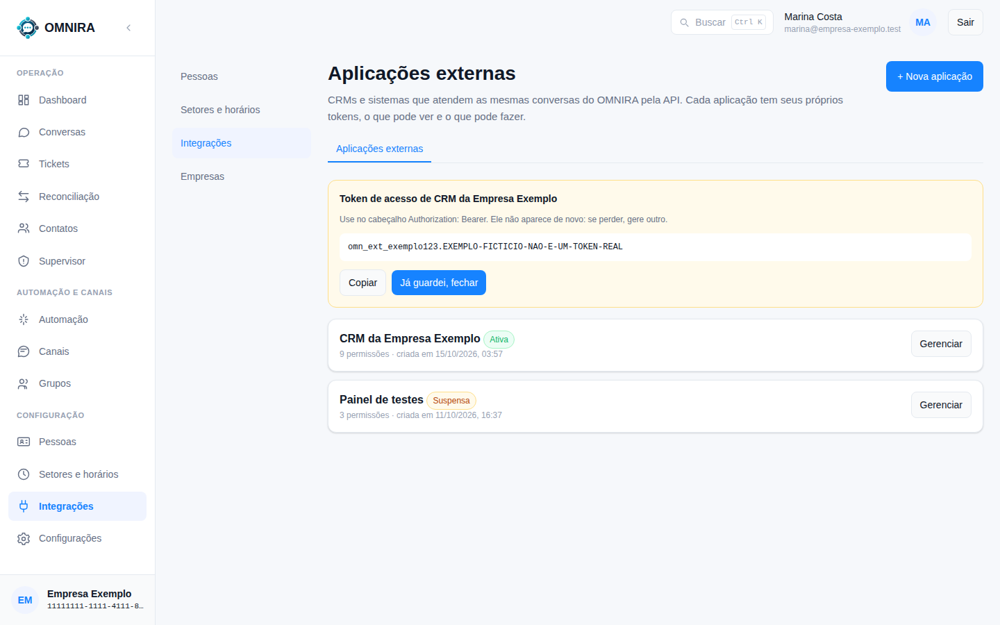
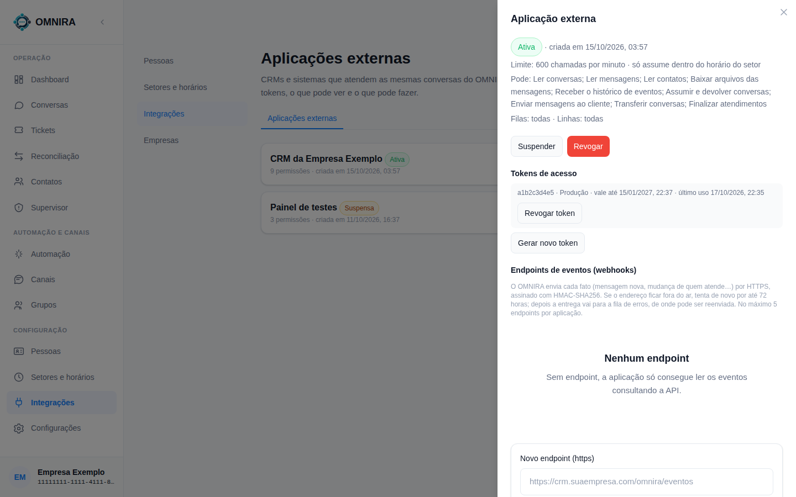

# Tutorial 6: conectar um CRM pelo painel (administrador)

**Para quem:** administrador da empresa. **Tempo:** 10 minutos. **No fim você tem:** uma aplicação criada, um token guardado em local seguro e o time do CRM pronto para testar.

Um CRM usa a **API do OMNIRA** para ver e atender as mesmas conversas que o time. Cada CRM é uma **aplicação externa**, com seus próprios tokens e permissões.

## 1. Abra Integrações

Menu **Integrações** → aba **Aplicações externas**. A lista mostra cada aplicação, a situação (**Ativa**, **Suspensa**) e quantas permissões tem.

## 2. Crie a aplicação

Clique em **+ Nova aplicação**.

| Campo | O que fazer |
|---|---|
| **Nome da aplicação** | O nome do CRM ("CRM da empresa") |
| **O que a aplicação pode fazer** | Marque só o necessário. Para um CRM que atende de ponta a ponta: ler conversas, mensagens e contatos, baixar arquivos, receber o histórico de eventos, assumir e devolver conversas, enviar mensagens, transferir e finalizar. Para começar **só olhando**, marque apenas as de leitura |
| **Filas / Linhas** | Vazio = todas. Marque para limitar a aplicação a algumas filas ou números |
| **Pode assumir conversas fora do horário do setor** | Desmarcado por padrão. Marque só se o CRM deve atender fora do expediente |
| **Validade do token (dias)** | Quanto tempo o token vale (padrão 90). Depois é preciso gerar outro |

As permissões que **escrevem** têm a etiqueta **escreve**. Receber eventos de protocolos, ocorrências e tarefas (`service`) é opcional.

Clique em **Criar aplicação**.

## 3. Guarde o token (ele aparece uma vez)

O token tem a forma `omn_ext_<id>.<segredo>`. **Copie e entregue ao time do CRM por um canal seguro** (gerenciador de senhas ou mensagem criptografada; nunca e-mail aberto ou chat comum). O OMNIRA guarda só um resumo: se perder, gere outro. Clique em **Já guardei, fechar**.

> O exemplo da imagem usa um token fictício.

## 4. Gerencie

Clique em **Gerenciar** na aplicação.

- O alto mostra a situação, o **limite de chamadas por minuto** (padrão 600), se pode assumir fora do horário, as permissões e as filas/linhas permitidas.
- **Suspender** corta o acesso na hora e **devolve ao roteador as conversas que a aplicação segurava**. Dá para reativar depois.
- **Revogar** é definitivo: os tokens deixam de valer e a aplicação não volta.
- **Tokens de acesso**: veja o prefixo, a validade e o último uso; **Revogar token** invalida um; **Gerar novo token** cria outro (também mostrado uma vez).
- **Endpoints de eventos (webhooks)**: opcional. A integração padrão **não precisa**: o CRM consulta o diário de eventos pela API. Sem endpoint, a aplicação só lê os eventos consultando.

## 5. O que o time do CRM faz agora

Entregue a eles o **pacote do integrador** (guia da API, roteiro de teste, contrato e o simulador). O roteiro exige você ao lado, com um telefone de teste, em alguns passos. Veja o [Tutorial 7](07-primeira-chamada-a-api.md).

## Boas práticas

- Uma aplicação por sistema; nunca compartilhe o token entre sistemas.
- Comece **só leitura**, confira por um dia, depois dê escrita.
- Teste numa empresa e numa linha de teste antes de conectar a operação real.
- Se algo estranho acontecer, **Suspender** primeiro e investigar depois.

## O que ainda não se ajusta nesta tela

O **limite de chamadas por minuto** (padrão 600) e o **prazo de titularidade** (o tempo que o CRM pode ficar calado antes de a conversa voltar à fila) são configurados pela API de administração; a tela mostra o limite mas ainda não o edita. Peça o ajuste à equipe do OMNIRA se precisar de um valor diferente.
