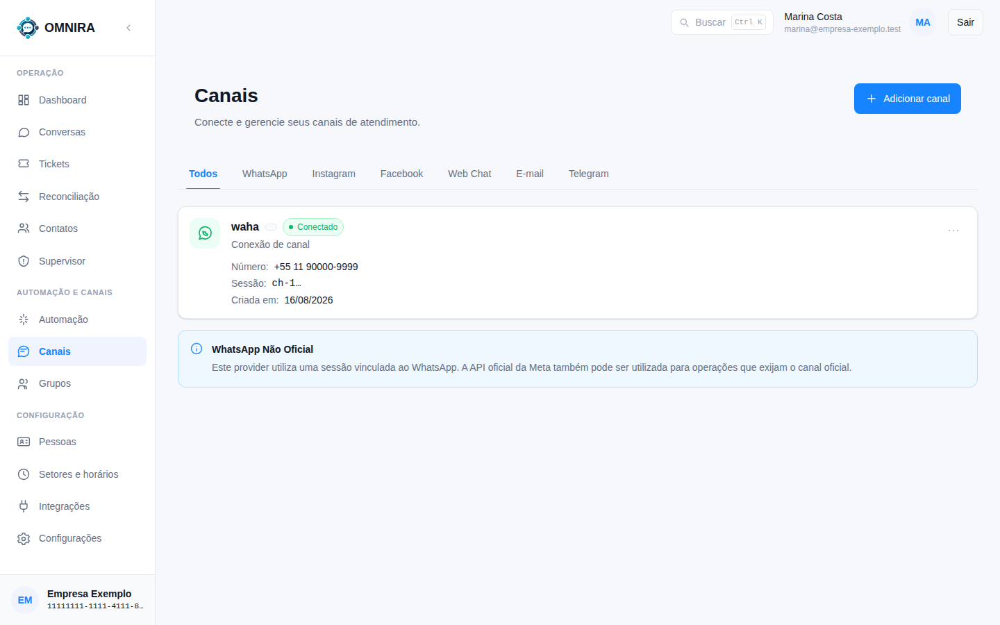
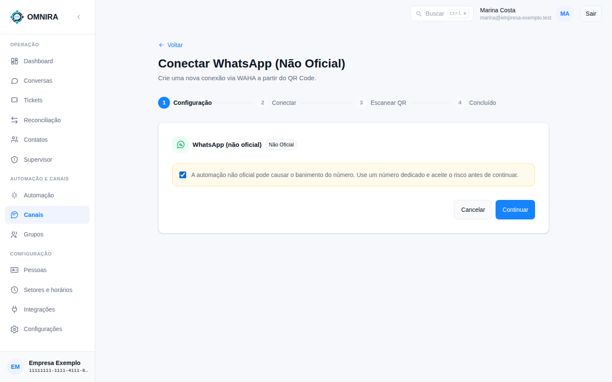
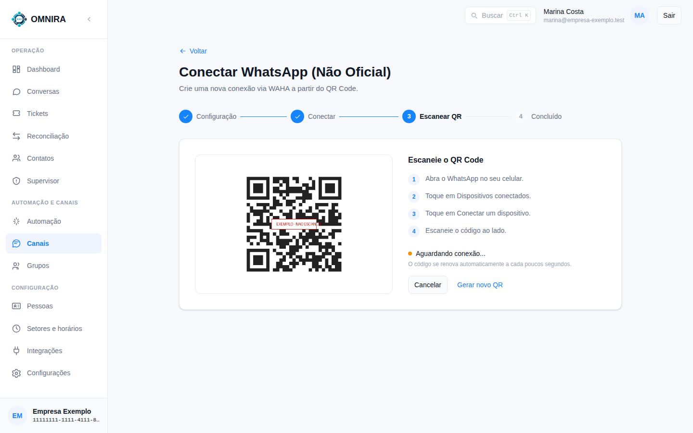
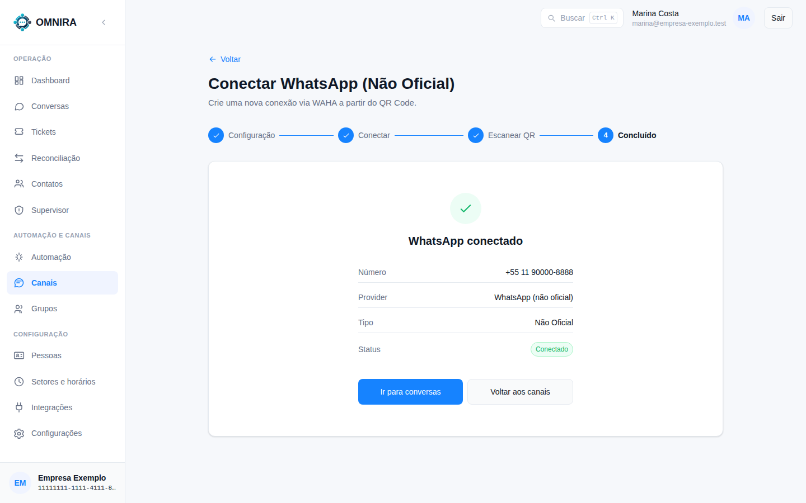

# Tutorial 8: conectar um número de WhatsApp

**Para quem:** administrador. **Tempo:** 5 minutos. **Você precisa de:** o celular com o WhatsApp do número que vai atender, e que seja um número **dedicado** à operação.

Em **Canais** ficam os números conectados. Aqui você conecta um **número não oficial** pelo QR Code, o mesmo que se usa no WhatsApp Web.

Cada número aparece com a situação (**Conectado**), o telefone e a sessão. As abas filtram por tipo de canal.

> **Atenção.** A conexão pelo QR Code é **não oficial**. O sistema avisa: "A automação não oficial pode causar o banimento do número. Use um número dedicado e aceite o risco antes de continuar." Use um número só da operação, nunca o pessoal. A conexão pela API oficial da Meta é outro caminho, descrito à parte.

## 1. Comece a conexão

Em **Canais**, clique em **Adicionar canal** e escolha **WhatsApp (não oficial)**. Abre o assistente de 4 passos: **Configuração**, **Conectar**, **Escanear QR** e **Concluído**.

Leia o aviso, marque a caixa para aceitar o risco e clique em **Continuar**.

## 2. Escaneie o QR Code

O sistema abre a sessão (leva alguns segundos, aparece "Preparando conexão...") e mostra o QR Code.

No celular do número:

1. Abra o WhatsApp.
2. Toque em **Dispositivos conectados**.
3. Toque em **Conectar um dispositivo**.
4. Escaneie o código da tela.

O código **se renova sozinho** a cada poucos segundos. Se expirar ou a tela não avançar, use **Gerar novo QR**. A tela fica em "Aguardando conexão..." até o WhatsApp confirmar. **Cancelar** desfaz a conexão.

> A imagem do QR acima é um exemplo, e não funciona.

## 3. Concluído

A tela mostra o **número**, o **provedor**, o **tipo** e a situação **Conectado**. Clique em **Ir para conversas** ou em **Voltar aos canais**.

## Depois de conectar

- Escolha **para qual fila** vão as conversas novas desse número, em **Setores e horários → Entrada por canal** ([Tutorial 5](05-filas-e-setores.md)). Sem escolha, vão para a fila padrão.
- Mande uma mensagem de outro celular para o número e confira se a conversa aparece em **Conversas**.

## Se der problema

| Você vê | O que fazer |
|---|---|
| "A sessão não pôde ser iniciada" | O serviço de conexão não abriu a sessão. Clique em **Tentar novamente** (ou **Reiniciar tentativa**) |
| "Esse número já está conectado." | O número já existe em Canais; não conecte duas vezes |
| O QR não aparece | Aguarde alguns segundos e clique em **Gerar novo QR** |
| O número desconecta depois de um tempo | O WhatsApp pode ter encerrado a sessão no celular; repita a conexão |
