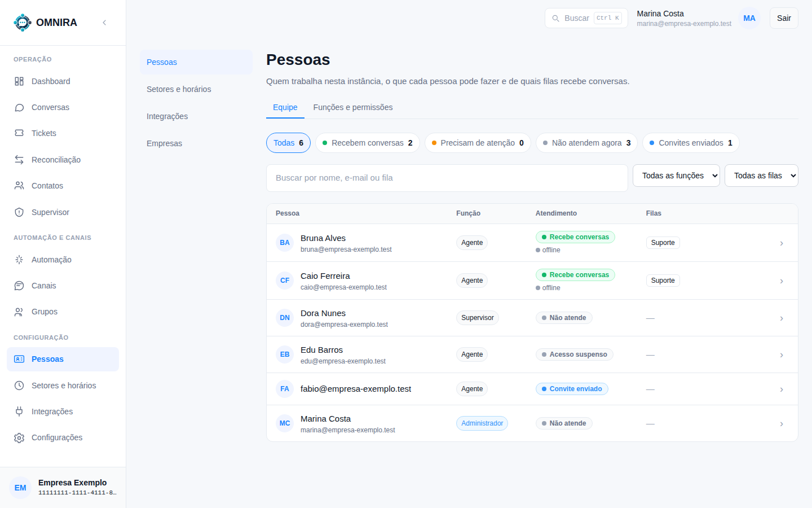
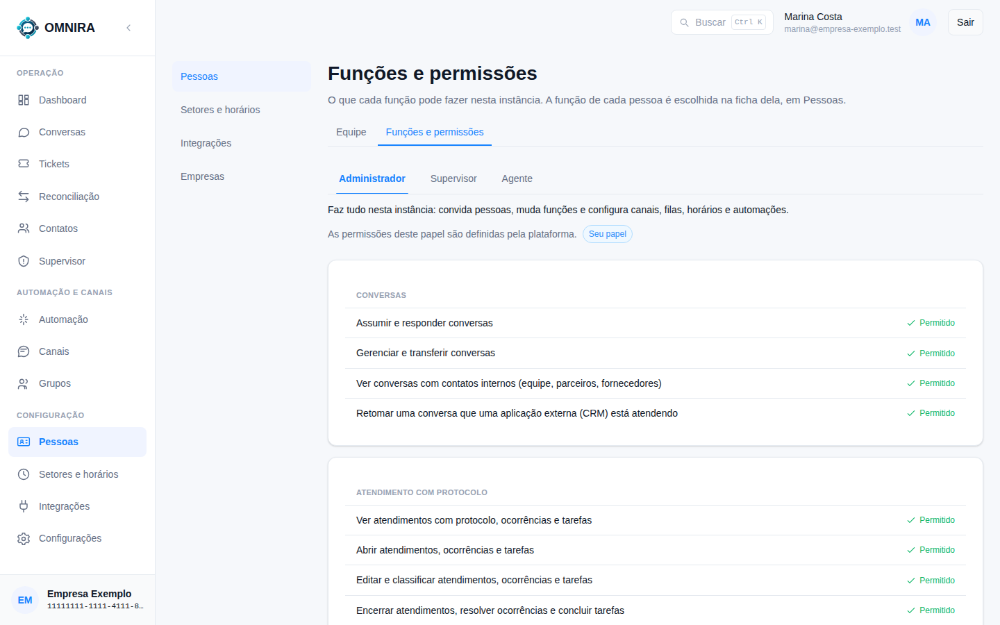

# Tutorial 9: pessoas, funções e permissões

**Para quem:** administrador. **Tempo:** 5 minutos.

Em **Pessoas** (menu **Configuração**) você vê **quem trabalha na empresa, o que cada pessoa pode fazer e de quais filas recebe conversas**. Não confunda com a tela **Contatos**, que lista os clientes.

## Equipe

No alto, os filtros rápidos contam quantas pessoas estão em cada situação:

| Filtro | Quem aparece |
|---|---|
| **Todas** | Todo mundo, inclusive convites |
| **Recebem conversas** | Quem está em alguma fila e pode receber |
| **Precisam de atenção** | Quem tem algum problema de configuração para atender |
| **Não atendem agora** | Quem não está recebendo (função sem atendimento, fora do turno etc.) |
| **Convites enviados** | Quem foi convidado e ainda não entrou |

A busca acha por nome, e-mail ou fila, e os menus filtram por função e por fila.

Cada linha mostra a **função** (Administrador, Supervisor, Agente), a situação de **atendimento** (por exemplo "Recebe conversas", "Não atende", "Acesso suspenso", "Convite enviado"), se a pessoa está **online ou offline** e as **filas** dela. Clique na linha para abrir a **ficha** da pessoa.

### Na ficha da pessoa

- **Função**: escolha entre as funções disponíveis.
- **Recebe conversas**: liga e desliga o atendimento da pessoa.
- **Filas**: marque as filas de onde ela recebe conversas e, em cada uma, as **Simultâneas** (quantas conversas ao mesmo tempo). **0 quer dizer sem limite.**
- **Suspender acesso**: a pessoa deixa de entrar e de receber, **sem perder função e filas**. **Reativar acesso** devolve tudo.

As mudanças só valem em **Salvar alterações**, com uma confirmação. Se fechar a ficha com alterações não salvas, o sistema pergunta antes.

### Convidar alguém

Quando a empresa tem envio de e-mail configurado, a tela oferece **convidar**. Você informa o **E-mail** e a **Função**, escolhe se a pessoa **Vai atender conversas** e, se for atender, as filas e as conversas ao mesmo tempo em cada uma (0 = sem limite). A pessoa recebe um link para criar o acesso. Quem ainda não aceitou aparece como **Convite enviado** e o convite pode ser reenviado ou cancelado enquanto está pendente.

## Funções e permissões

A aba **Funções e permissões** mostra, para cada função, **o que ela pode e o que não pode fazer**, em grupos (Conversas, Atendimento com protocolo e outros).

- **Administrador**: faz tudo na empresa: convida pessoas, muda funções e configura canais, filas, horários e automações.
- **Supervisor**: acompanha a operação e pode retomar uma conversa que um aplicativo externo está atendendo, entre outras coisas.
- **Agente**: atende conversas.

As permissões de cada função são **definidas pela plataforma** e só se leem aqui; o que muda é **qual função cada pessoa tem**. A função da pessoa aparece marcada como **Seu papel** na sua própria visão.

## Boas práticas

- Dê a cada pessoa a **menor função** que resolve o trabalho dela.
- Quando alguém sair da empresa, **suspenda o acesso** (não precisa apagar nada).
- Se a empresa usa **visibilidade por setor**, a pessoa só enxerga as filas dela; supervisor e administrador veem todas.
