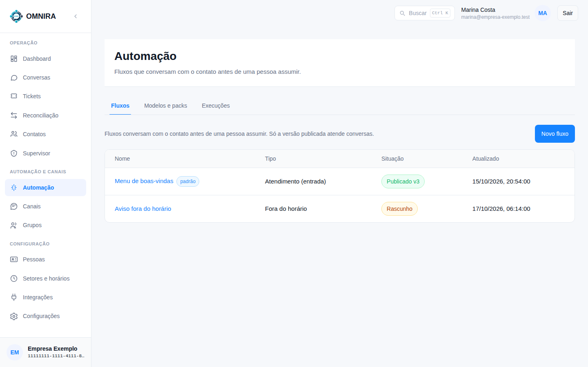

# Tutorial 10: automação (fluxos)

**Para quem:** administrador. **Tempo:** 3 minutos para conhecer a tela.

**Automação** reúne os **fluxos**: conversas automáticas com o cliente **antes de uma pessoa assumir**, como um menu de boas-vindas ou um aviso de fora do horário.

## A tela

Três abas: **Fluxos**, **Modelos e packs** e **Execuções**.

Em **Fluxos**, cada linha mostra:

- **Nome** (clique para abrir o editor). A etiqueta **padrão** marca o fluxo que atende por padrão.
- **Tipo**, por exemplo **Atendimento (entrada)** ou **Fora do horário**.
- **Situação**: **Rascunho** (ainda em edição) ou **Publicado vN** (a versão em uso).
- **Atualizado**: quando foi mexido.

**Só a versão publicada atende conversas.** Um rascunho pode ser editado à vontade sem afetar nenhum cliente; ao **publicar**, nasce uma versão nova que passa a valer.

**Novo fluxo** cria um fluxo. **Modelos e packs** traz fluxos prontos para instalar. **Execuções** mostra o que cada fluxo fez em cada conversa.

## O que o cliente vê

As mensagens do fluxo aparecem na conversa com o rótulo **Automação** e, para a equipe, uma linha de evento mostra quando a conversa foi entregue a uma pessoa. Quando uma pessoa assume, o fluxo para.

## Quando o fluxo não fala

- **O CRM está com a conversa**: enquanto um aplicativo externo atende, o bot **não** fala por cima.
- **O contato é interno ou spam**: não recebe a automação de cliente.
- **Não há fluxo publicado** para aquele tipo de situação.

## Cuidados

- Teste num número de teste antes de publicar.
- Edite sempre o **rascunho** e publique só quando estiver pronto.
- Fluxos que perguntam e esperam resposta podem mandar **lembretes** e, depois de um tempo sem resposta, **encerrar** a conversa. Confira esses tempos antes de publicar.
