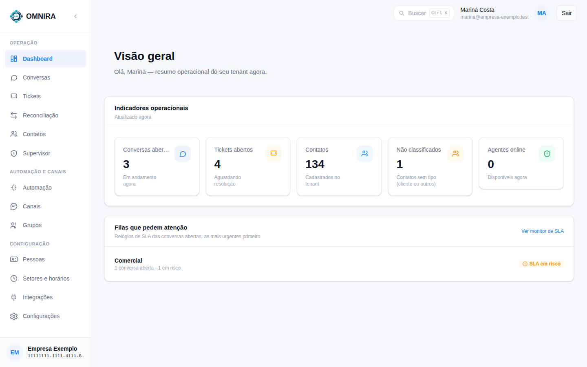
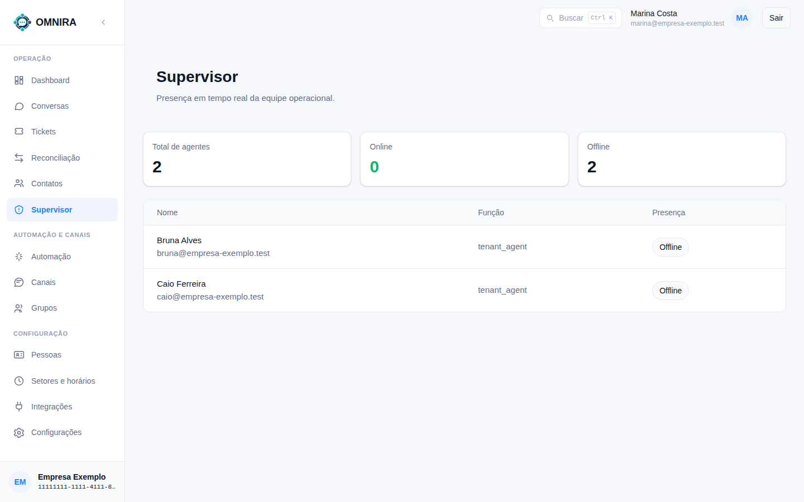

# Tutorial 11: acompanhar a operação (Dashboard e Supervisor)

**Para quem:** supervisor e administrador. **Tempo:** 3 minutos.

## Dashboard

O **Dashboard** é o resumo do momento.

- **Conversas abertas**, **Tickets abertos**, **Contatos**, **Não classificados** e **Agentes online**. Cada cartão leva à lista correspondente.
- **Filas que pedem atenção**: as filas com conversas cujo **relógio de SLA** está em risco ou estourou, as mais urgentes primeiro. **Ver monitor de SLA** abre a tela de transbordo e SLA ([Tutorial 12](12-horarios-escalas-e-transbordo.md)). Se nenhuma fila corre risco, a tela diz "Tudo em dia".

## Supervisor

**Supervisor** mostra a **presença da equipe em tempo real**.

- **Total de agentes**, quantos estão **Online** e quantos **Offline**.
- A lista traz cada pessoa, a função e a presença.

Uma pessoa só fica **online** quando está com o OMNIRA aberto; é a presença que o roteador usa, junto com o turno e a capacidade, para decidir quem recebe a próxima conversa (veja o [Tutorial 12](12-horarios-escalas-e-transbordo.md)).

## Retomar uma conversa que um CRM atende

Se um aplicativo externo está com uma conversa e algo deu errado, um supervisor com a permissão certa pode **retomar** a conversa, informando o motivo. A permissão aparece em **Pessoas → Funções e permissões**: "Retomar uma conversa que uma aplicação externa (CRM) está atendendo".
