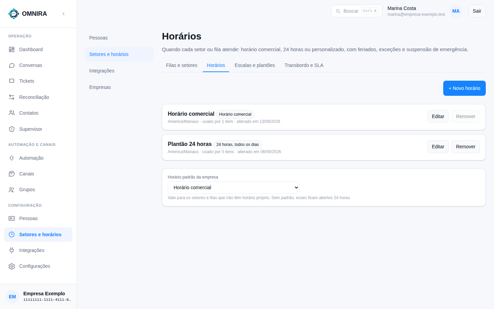
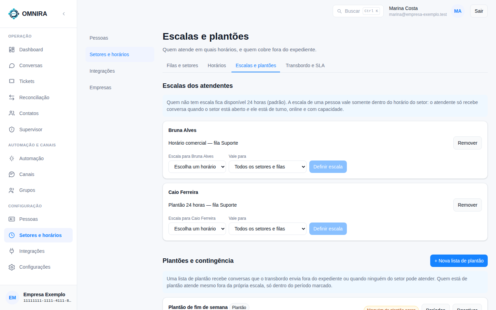
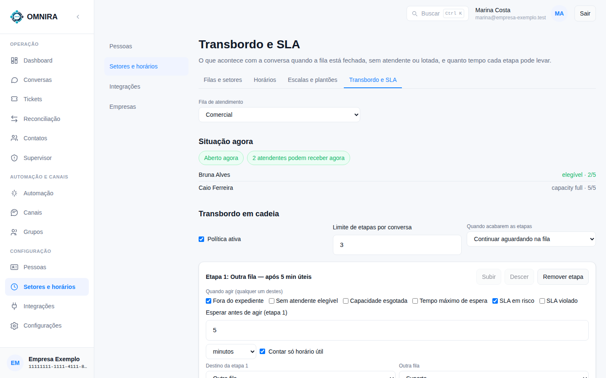

# Tutorial 12: horários, escalas e transbordo

**Para quem:** administrador e supervisor. **Tempo:** 10 minutos para entender.

Em **Setores e horários** há quatro abas que trabalham juntas ([Tutorial 5](05-filas-e-setores.md) explica **Filas e setores**). Este tutorial cobre as outras três.

## Horários

Define **quando cada setor ou fila atende**.

- Cada horário tem nome e tipo (**Horário comercial**, **24 horas, todos os dias** ou **personalizado**), o fuso horário e **quantos itens o usam**. Um horário em uso não pode ser removido.
- **+ Novo horário** cria outro; **Editar** ajusta os dias, os intervalos, **feriados**, **exceções** e a **suspensão de emergência**.
- **Horário padrão da empresa** vale para os setores e filas que não têm horário próprio. Sem padrão, ficam abertos 24 horas.

## Escalas e plantões

Define **quem atende em quais horários e quem cobre fora do expediente**.

- **Escalas dos atendentes**: quem não tem escala fica disponível 24 horas (padrão). A escala de uma pessoa vale **somente dentro do horário do setor**: o atendente só recebe conversa quando o setor está **aberto**, ele está **de turno**, **online** e **com capacidade**.
- Para cada pessoa, escolha o **horário** e a que **setores e filas** ele vale, e clique em **Definir escala**. **Remover** volta ao padrão.
- **Plantões e contingência**: uma lista de plantão recebe conversas que o **transbordo** manda **fora do expediente** ou quando **ninguém do setor pode atender**. Quem está de plantão atende mesmo fora da própria escala, **só dentro do período marcado**. **+ Nova lista de plantão** cria uma; cada lista tem **Períodos**.

## Transbordo e SLA

Define **o que acontece com a conversa** quando a fila está fechada, sem atendente ou lotada, **e quanto tempo cada etapa pode levar**.

1. Escolha a **Fila de atendimento**.
2. **Situação agora** mostra **quem pode atender agora** e por que alguém não pode (por exemplo, capacidade cheia).
3. **Transbordo em cadeia**: marque **Política ativa**, defina o **Limite de etapas por conversa** e o que fazer **quando acabarem as etapas** (por exemplo, **Continuar aguardando na fila**).
4. Cada **Etapa** diz **quando agir**: **Fora do expediente**, **Sem atendente elegível**, **Capacidade esgotada**, **Tempo máximo de espera**, **SLA em risco** ou **SLA violado** (basta um deles). Depois define **quanto esperar** (em minutos, opcionalmente só no **horário útil**) e o **destino**: **Outra fila**, **Plantão** ou **Atendente específico**.
5. As etapas podem ser reordenadas (**Subir** e **Descer**) ou removidas.
6. Mais abaixo fica a **política de SLA**: os prazos de **primeira resposta**, **espera na fila**, **atribuição** e **resolução**, com o **percentual de risco** (quando o relógio passa a "em risco") e se a contagem é **corrida** ou só em **horário útil**.

O **SLA** é o prazo combinado. O sistema acompanha um relógio por conversa; quando ele passa do risco, a conversa aparece em **Filas que pedem atenção** no Dashboard, e pode disparar o transbordo.

## Um exemplo

"Se o Suporte estiver fechado ou sem ninguém disponível, espere 5 minutos úteis e mande para o plantão. Se ninguém do plantão pegar, continue aguardando na fila." É uma política de uma etapa: gatilhos **Fora do expediente** e **Sem atendente elegível**, espera **5 minutos úteis**, destino **Plantão**, e ao acabar as etapas **Continuar aguardando na fila**.
